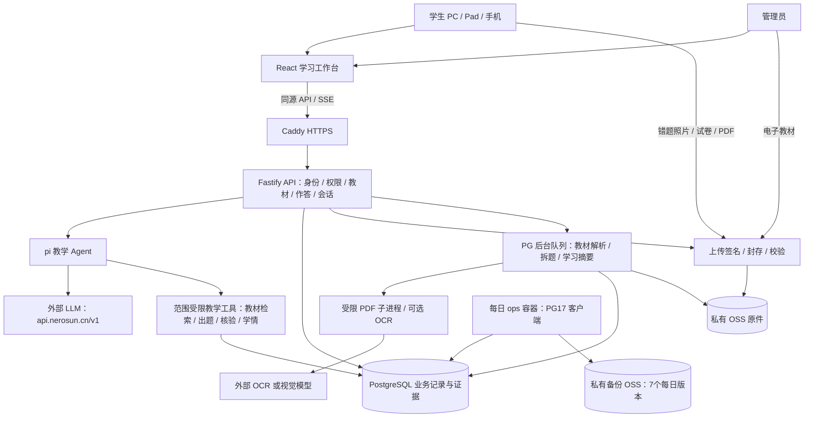

# 初版技术栈与架构

| 层 | 实现 |
|---|---|
| 学生/管理员Web | React19、TypeScript、Vite、React Router、Tailwind4、Radix、Lucide |
| 教学内容展示 | Markdown、KaTeX、响应式森林绿学习工作台 |
| API | Node22、Fastify5、Zod、同源Cookie会话、SSE |
| Agent | pi-agent-core + pi-ai；工具绑定当前学生/任务/教材修订 |
| 模型 | 外部OpenAI兼容服务，base URL预设api.nerosun.cn/v1 |
| 业务记录 | PostgreSQL + Drizzle迁移；追加作答、消息版本、状态证据 |
| 教材与原件 | 私有OSS；文本PDF解析、受限子进程；OCR可配置 |
| 异步任务 | PostgreSQL持久队列、租约心跳、单任务处理 |
| 部署 | Caddy HTTPS + Node + PG17；每日ops备份容器按需运行 |

管理员上传教材先核对再发布。学生选择版本→年级→科目后进入pi；首页操作触发开场或学习任务。学生试卷先确认所选题，只有有依据的错题才加入错题本。原题历史、当前学习状态、长期观察分别保存，全部关联证据；不存内部思维链。

初版不部署Redis、向量库或腾讯L0–L3记忆。2核2GiB/40GB采用单实例和资源上限；真实容量需按运维手册在ECS实测。
