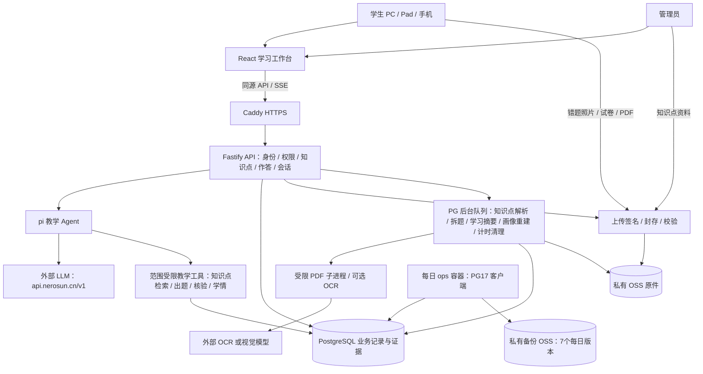

# 初版技术栈与架构

| 层 | 实现 |
|---|---|
| 学生/管理员Web | React19、TypeScript、Vite、React Router、Tailwind4、Radix、Lucide |
| 教学内容展示 | Markdown、KaTeX、响应式森林绿学习工作台 |
| API | Node22、Fastify5、Zod、同源Cookie会话、SSE |
| Agent | pi-agent-core + pi-ai；工具绑定当前学生/任务，答疑出题检索已发布知识点 |
| 模型 | 外部OpenAI兼容服务，base URL预设api.nerosun.cn/v1 |
| 业务记录 | PostgreSQL + Drizzle迁移；追加作答、消息版本、状态证据 |
| 知识点与原件 | 管理员上传文本/图片/文档，模型拆分为待确认条目；原件存私有OSS；PDF解析、受限子进程、OCR可配置 |
| 异步任务 | PostgreSQL持久队列、租约心跳、单任务处理；含画像重建与每日计时清理 |
| 部署 | Caddy HTTPS + Node + PG17；每日ops备份容器按需运行 |

管理员上传知识点资料，模型拆分后逐条核对再发布；未确认条目对学生和检索不可见，重新解析不覆盖已发布内容。学生登录后直接进入pi，不再选择年级、科目或教材；首页操作触发开场或学习任务。agent 答疑、讲解和出题只依据检索到的已发布知识点，无命中时声明依据不足。学生试卷先确认所选题，只有有依据的错题才加入错题本。原题历史、当前学习状态、长期观察分别保存，全部关联证据；不存内部思维链。

初版不部署Redis、向量库或腾讯L0–L3记忆。2核2GiB/40GB采用单实例和资源上限；真实容量需按运维手册在ECS实测。

自适应学习按阶段开放，四项能力各有一个默认关闭的开关：自查与提示、计时、个性化练习、学情评估。画像重建与练习选择复用同一个PG队列，不引入额外中间件；每日调度器只入队一次`learning_timing.cleanup`，由队列的dedupe key保证多实例或重启不会重复执行。计时清理按主键分批删除已封存且已聚合、超过保留期的原始事件，快照与冻结指标保留，因此回退只需关闭开关，不做破坏性迁移。详见[运行手册](runbooks/adaptive-learning.md)。
