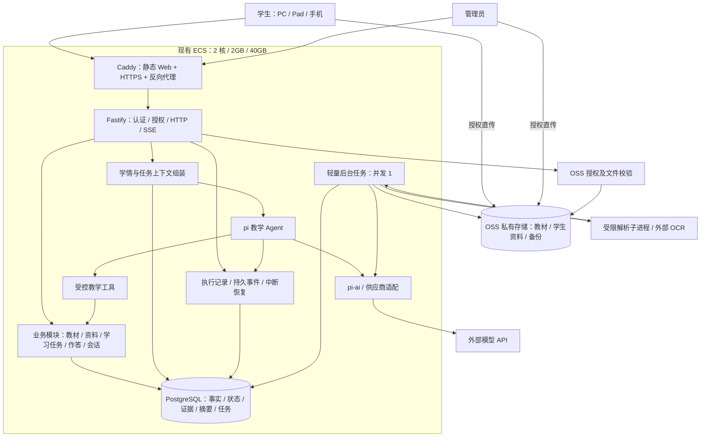

# XY Tutor 初版项目设计

日期：2026-11-08（Asia/Shanghai）  
状态：用户已于 2026-11-08 确认；已进入实施计划编写，尚未开始产品实现  
项目目录：`/Users/nerosun/裂缝中的阳光/sxy/日常/xy-tutor`

## 1. 目标与已确认约束

构建一个以 pi 教学 Agent 为核心的学习 Web 应用。学生选择教材版本、年级和科目后，获得符合实际进度的学习引导，也可以上传错题、作业和试卷。系统持续保存教学证据，并据此更新错题状态与学情。

已确认：

- 初期为开发者自己和两三个用户轻度使用；增长后升级服务器。
- 当前 ECS：Ubuntu 24.04、2 vCPU、2GiB RAM、40GB 磁盘；公网带宽、实例族和当前剩余资源尚未确认。
- LLM 通过供应商 API 调用，不在 ECS 部署本地模型。
- 使用 pi 构建教学 Agent；PostgreSQL 为业务主数据库；阿里云 OSS 保存原始文件。
- 管理员（含开发者）上传、检查和发布电子教材。
- 学生进入辅导前选择版本（如人教版、苏教版）、年级、科目。
- 学生可上传自己的错题、考试照片、作业和 PDF；上传不等于自动认定所有题都是错题。
- 教学支持主动开场与任务入口：每日5练、知识点巩固、错题回顾、继续上次、上传资料、自由提问。
- PC、Pad、手机均可使用；UI 需要美化、统一风格。
- 错题历史、当前状态、Agent 辅助记忆分别保存并相互关联。初版不接腾讯 L0–L3 Memory。

成功标准：普通用户能在手机或电脑上完成“选教材 → 开始任务/上传资料 → 分步辅导 → 保存作答和证据 → 下次继续”，管理员能发布一本可实际检索引用的教材。

## 2. 方案选择与默认值

### 2.1 架构取舍

| 方案 | 优点 | 代价 | 结论 |
|---|---|---|---|
| TypeScript 模块化单体，pi 嵌入 Node.js | 一套语言；业务与 Agent 工具直接调用；常驻服务少 | 需要明确模块边界，重解析必须外置执行 | 沿用对话中已确认的方向 |
| Python/FastAPI 业务层 + Node pi 服务 | 便于 Python 文档/计算生态 | 两种运行时、跨服务鉴权与调用、更多部署资源 | 当前规模不采用 |
| 多微服务、独立队列/向量库 | 各部分独立扩展 | 运维、内存和故障面扩大 | 后续确有需求再拆 |

### 2.2 本文提出的默认值（可在审阅时调整）

1. 邀请制账号，管理员创建账号并发放一次性激活凭据；不做公开注册、短信登录和付费。
2. 初版每个普通账号对应一个学生档案；数据库保留账号与学生授权关系，便于后续家庭多孩子。
3. 管理员管理公共教材；不会因管理员身份自动获得所有学生私有资料的访问权。访问私有内容需显式授权并记录审计。
4. 年级、科目为数据配置，界面不硬编码唯一学段。首轮端到端验收以“一套教材中的一个数学单元”为样本；其他科目可配置、可对话，但学科专用评分规则不宣称全部完成。
5. 一次学习任务绑定一本教材修订版本，后续可多次会话继续；切换教材创建新任务/会话。
6. 初版提供全部学习入口的基础闭环；精细知识图谱、自动长期复习调度、复杂掌握度模型后置。
7. 外部 OCR 服务品牌及 LLM 型号暂不指定，通过适配接口配置；实现真实接入前需提供服务凭据并完成能力探测。
8. 视觉规范属于本设计范围，最终配色/字体等视觉方案在 UI 开发前做集中选择，本文不虚构已获用户认可的视觉稿。

## 3. 初版范围

### 3.1 必须交付

- 项目初始化、类型检查、迁移、测试、环境变量样例、本地启动与 ECS 部署说明。
- 邀请制登录、退出、激活/重设密码、学生与管理员权限控制。
- 学生资料和教材选择；上下册、年份/版次在有多本时明确区分。
- 管理员教材上传、解析、预览检查、发布/停用、修订版本管理。
- 学生图片/PDF 上传、处理状态、识别确认、整卷候选题拆分、选题辅导。
- 学习首页、自动开场、任务入口、任务创建/恢复/完成、pi 流式教学。
- 作答、提示、判题、来源引用、消息版本、Agent 执行和工具记录持久化。
- 错题新增、筛选、历史、基础状态规则、变式巩固和手动进入到期复习。
- 带证据的任务摘要、跨会话上下文读取、后续操作建议。
- 三端响应式布局与统一 UI 规范、加载/空/错误/排队/中断状态。
- 日志轮转、备份恢复流程、数据隔离、并发限制与模型调用预算。

### 3.2 后置

腾讯 Memory、Redis、独立向量数据库、pgvector 语义检索、复杂多 Agent、原生 App、离线模式、推送通知、支付、班级管理、实时语音、手写笔迹编辑器、全学科自动可靠评分、大批量并行扫描教材解析。

### 3.3 不应出现的结果

- 只有聊天壳，没有可追溯的作答和任务记录。
- 选择了教材但检索时混用其他版次；教材更新导致旧引用失效。
- 用一句总结代替掌握证据；提示后答对直接标记已掌握。
- 把整张试卷都当错题；把识别不确定的题当成已确认事实。
- 漂亮页面只适配桌面；手机键盘遮挡输入；每页组件和配色风格不一致。

## 4. 技术栈和代码边界

| 层 | 技术 | 职责 |
|---|---|---|
| Web | React、Vite、TypeScript、React Router | 学生端和管理端；产物为静态文件 |
| UI | Tailwind CSS、shadcn/ui、Lucide 图标 | 基于统一设计 token 组织组件 |
| 公式/内容 | KaTeX、Markdown 渲染与清洗 | 公式、讲解、可点击的来源引用 |
| API | Node.js 当前受支持 LTS、Fastify、TypeScript | 登录、授权、业务、SSE |
| Agent | pi-agent-core、pi-ai | 教学循环、工具执行、供应商适配 |
| 校验 | Zod；pi 工具按固定版本的 schema 约定适配 | API、模型结构化输出与工具参数校验 |
| 数据 | PostgreSQL、Drizzle ORM、node-postgres | 迁移、查询、事务、小连接池 |
| 文件 | 阿里云 OSS SDK | 授权直传、短期下载地址、备份 |
| 任务 | PG 任务表 + 同进程轻量调度 | 领取、租约、重试、去重、恢复 |
| 入口/部署 | Caddy、Docker Compose | HTTPS、静态文件、反向代理 |
| 验证 | Vitest、API 集成测试、Playwright | 规则、隔离、教学闭环、三端交互 |

pi 当前官方文档：

- [Agent 运行时](https://github.com/earendil-works/pi/blob/main/packages/agent/README.md)
- [模型 API](https://github.com/earendil-works/pi/blob/main/packages/ai/README.md)

原 badlogic/pi-mono 地址当前跳转至 earendil-works/pi；当前文档包名为 `@earendil-works/pi-agent-core`、`@earendil-works/pi-ai`。初始化时核验可安装的配套发布版本，使用锁文件固定；不混用旧作用域和新作用域 API。

供应商需验证：工具调用、流式输出、图像输入（可以是单独识图模型）、超时取消、实际上下文限制；“兼容接口”不代替实测。不满足时在适配层明确禁用对应能力，不能静默降级为假结果。

建议目录（本次仅写设计，不创建产品脚手架）：

```text
apps/web/                  React 路由、页面、组件、样式
apps/server/src/
  modules/auth/            身份与授权
  modules/catalog/         教材目录和发布
  modules/materials/       文件、解析、确认
  modules/learning/        任务、作答、错题、状态规则
  modules/conversations/   消息版本、执行与事件
  agent/                   pi 适配、提示词、上下文、工具
  jobs/                    后台任务领取和执行
  infra/                   PG、OSS、供应商、日志
packages/contracts/        前后端 DTO 和错误码
packages/db/               表定义和迁移
infra/                     Compose、Caddy、备份脚本
```

## 5. 系统架构



后台调度和 API 同属一个 Node 进程；PDF 解析涉及 CPU/原生库时使用可取消的受限子进程，不阻塞事件循环。扫描 OCR 调用外部服务。原始文件不存进 PG。

## 6. 用户和教材流程

### 6.1 账号与权限

- 服务器初始化命令创建首个管理员，不公开暴露初始化接口。
- 管理员创建邀请；激活凭据单次使用、设有效期，数据库只保存哈希。忘记密码先由管理员签发重置凭据，不接邮件/短信。
- 密码使用 scrypt 存储，登录限速；服务端 session 存 PG，Cookie 使用 HttpOnly、Secure、SameSite；同源写请求校验 Origin/CSRF。
- 用户只访问授权 student_id 的私有资源；管理员教材权限与学生私有数据权限独立。
- OSS bucket 私有；上传/下载前均授权，object key 由服务器生成，不接收任意 key 作为访问授权。

### 6.2 教材目录与发布

教材唯一身份包含出版社/版本、学段年级、科目、上下册、年份/版次；与不可变的内容修订版本分开。

状态：draft → processing → review → published → disabled；解析失败进入 failed，可重试。

1. 管理员填写元数据并直传 PDF。
2. 后端完成上传校验后创建解析任务；保留物理 PDF 页序号和印刷页标签，二者不可混淆。
3. 提取文字、章节和按页片段；扫描页走 OCR。公式和图片保留原页引用，不能只依赖抽出的纯文本。
4. 管理员预览关键页，修正章节/文字；发布前要求全部页处理完成或明确剔除失败页，且教材片段可检索。
5. 发布后内容不可原位修改；修正生成新修订。停用从新选择列表隐藏，旧会话仍可读取其绑定修订的引用。

### 6.3 学生入口

版本 → 年级 → 科目 → 教材（上下册、年份/版次）。选项由已发布目录联动，记住偏好但不隐藏当前选择。没有教材时显示待提供教材及联系管理员，不使用其他版本冒充。

## 7. 学生资料：错题、作业和试卷

建议初始限制：JPEG/PNG/WebP 单图 ≤10MB，PDF ≤30MB / 100页；服务端验证实际类型、页数和解压后图像大小。上限可配置，不把整本扫描教材一次提交给模型。

流程：授权上传 → 完成校验 → 排队解析 → 识别预览 → 学生确认/修正 → 选题 → 创建学习任务。

- material 保留来源类型、所有者、教材上下文、原始文件；page 保留页面；extraction 保留模型、提示词版本和原始结构化识别结果。
- 每题保留页面和规范化坐标区域，可回看原图。跨页题允许关联多个区域。
- 识别题干、可见学生答案和可见教师批注；不能把教师批注当学生答案。
- 学生确认后产生题目版本与可选的导入作答；无法识别部分要求补图/输入，允许只确认部分题目。
- 整卷拆题以候选结果呈现，允许合并、拆分和修改；不承诺对任何版式全自动正确。
- 上传试卷不自动加入错题本；学生手动标记，或确认判错后加入。错误题目识别修订后，旧作答仍引用原版本。
- 初版不做跨用户题目自动去重，避免把私有题图通过公共题库泄露。

## 8. pi 主动教学和学习任务

### 8.1 自动开场

页面 ready 后由客户端调用幂等 bootstrap 接口。服务端读取绑定教材、近期摘要、待处理错题、未完成任务和学习范围，触发一次 pi 开场；同一学习入口会话只生成一次，刷新返回已有结果。

固定任务入口始终可用；模型失败仍展示基础欢迎语和按钮。开场可以推荐任务，但不得声称没有证据的薄弱点。学生未选择任务时，开场只做推荐，不自动批量出题。

这是应用事件触发的主动教学，不是 Agent 在用户离线时自主发送消息。

### 8.2 任务类型与完成条件

| 任务 | 行为 | 基础完成条件 |
|---|---|---|
| 每日5练 | 确认学习范围，逐题提供5题，可按回答调整剩余题 | 5题均有最终作答或明确跳过；未完成可继续 |
| 知识点巩固 | 选章节/知识点，诊断、提示、讲解、独立练习 | 至少一次诊断和一次独立练习后生成小结；允许提前结束 |
| 错题回顾 | 从待订正、待巩固或到期列表选题 | 本次选定题完成处理或明确跳过；不等于全部掌握 |
| 上传资料辅导 | 解析确认后选择题目，按题引导 | 选定题处理完成或学生结束 |
| 自由提问 | 基于教材答疑，可转成练习任务 | 学生结束后摘要 |
| 继续上次 | 恢复未完成任务 | 沿用原任务，不创建新的任务类型 |

每日练习默认由学生确认当前章节/知识点，未知范围时先问最近学到哪里。已确认进度可用于下次默认推荐。知识点初版采用管理员可编辑的教材章节标签，不构建完整知识图谱。

任务状态：active / paused / completed / abandoned；run 状态：queued / running / succeeded / failed / interrupted / cancelled。任务和执行分开，一个任务可跨会话、多次执行。

### 8.3 教学与评估

- 教学循环：观察学生回答 → 定位困难 → 分层提示 → 独立尝试 → 核验 → 下一题/小结。
- 首次错误优先提问，不直接长篇给出完整答案；学生明确要求讲解时可以讲解，之后的作答按已接触解法处理。
- Agent 暴露结构化教学意图，如 question、hint、explanation、assessment、next_actions；前端使用统一卡片展示。
- 模型生成练习先生成待验证题目版本、参考答案和解题依据，再进行一次独立评估调用；不一致则重试一次，仍不一致就换题/待核验。同模型复核不等于数学证明。
- 评估记录 correctness=correct/incorrect/uncertain，verification=verified/pending/rejected。只有通过检查的确定结果可驱动升级；无法可靠判分的开放题保留反馈但不推进掌握状态。
- assessment verification 由业务层 AssessmentVerifier 设置，Agent 工具只能提交候选判断，不能自行将结果标为 verified。核验门槛作为版本化策略保存：
  - 题目有已确认参考答案、答案类型受支持且题意只要求最终值时，用受限的数值/分数/选项规范化比较核验。需要过程的题不能只因最终值相同而通过。
  - 其余具备已确认题干、可靠参考答案或教材依据的封闭题，采用独立评估调用：只提供题目、学生原始作答、参考依据和评分要求，不提供教学 Agent 的判定结论；可使用同一供应商模型，但调用上下文独立。两个判断的正确性结论与关键评分要求一致且引用有效，才由服务标 verified；该策略是初版工程门槛，不保证判题绝对正确。
  - 不一致、题目识别未确认、参考依据不足、开放题或超出核验支持范围，保持 pending/uncertain，提示暂无法可靠判定；不自动推进或回退状态。学生仍可查看讲解、修改输入、重新核验或换题，不阻塞其他学习任务。
  - 核验任务保存 verifier 类型、版本、两个评估结果及证据；失败重试有上限。用户质疑已核验判断时允许申请重新核验，通过追加更正记录撤销失效证据并重算状态。
- 不执行模型生成的任意代码。学科专用判题器留给后续。
- 提示依赖根据服务端记录推导：none / guided / solution_exposed / unknown，不让模型自行清空已有提示。已泄露解法的原题不能再算独立练习。

### 8.4 Agent 工具边界

| 工具 | 读写能力 |
|---|---|
| get_student_context | 读取当前授权学生的进度、任务和证据摘要 |
| search_textbook | 只检索任务绑定的教材修订 |
| get_material_question | 读取当前学生已确认题目及授权原图 |
| get_mistake_history | 读取当前学生相关错题及作答 |
| propose_practice | 提交候选练习，经验证后入库并展示 |
| submit_assessment | 提交结构化判断及 evidence IDs，业务服务校验 |
| propose_next_actions | 推荐允许的任务动作，前端以按钮呈现 |

工具不接受模型自定的访问主体；student_id、user_id、教材修订、run_id 由服务器绑定。工具不能执行 shell、任意 SQL、任意 URL 抓取或改管理员配置。

## 9. 数据模型与一致性

### 9.1 核心表

| 表组 | 实体及关键关系 |
|---|---|
| 账号 | users、auth_sessions、invitations；student_profiles、student_access |
| 教材 | curriculum_editions、grades、subjects、textbooks、textbook_revisions、chapters、textbook_chunks |
| 文件 | files（owner、用途、object key、hash、状态）；materials、material_pages、extractions |
| 题目 | questions、question_versions、question_sources；私有题归属学生，教材题归属教材修订 |
| 任务 | learning_tasks、task_items（题目版本、顺序、跳过状态、练习角色） |
| 会话 | conversations、messages（逻辑消息）、message_versions、agent_runs、run_events、tool_calls |
| 作答 | attempts、attempt_evidence、hints、assessments（追加评估版本） |
| 错题 | student_mistakes、mistake_state_events；规则版本、依据 attempt/assessment |
| 学情 | knowledge_observations、student_knowledge_states、learning_summaries、summary_evidence |
| 维护 | jobs、audit_events |

所有业务时间用 timestamptz 存储，界面按 Asia/Shanghai 显示；“每日”使用学生时区（初版默认上海）。UUID 主键，外键明确关联；核心关系使用列与约束，JSONB 仅保存扩展结构。

### 9.2 历史和版本

- 学生答案经 API 保存为不可变 attempt，绑定题目版本、任务、消息版本和时间。修改后新增版本/作答，不覆盖原始记录。
- 重新生成 Agent 回复新增消息，记录 regenerated_from；编辑保留版本。
- 历史证据始终指向具体版本。编辑影响既有判断时追加 invalidation/correction，重算当前投影，不能让新文字继承旧掌握证据。
- hints 记录内容、级别、对应题目和已展示时间；保守把已发送给学生的解法视作已接触。
- 原始用户和助手可见内容、工具参数结果、引用和模型标识可审计；不保存模型内部思维链。模型消息落库前剔除 reasoning/thinking 内容，只保留公开回答及必要计量元数据。
- 删除需求采用显式数据清理流程；正常订正/归档不是删除。私有资料撤销访问后不能通过旧签名链接长期继续访问，下载授权短期有效。

### 9.3 事务与去重

- 创建 attempt、应用 assessment、写状态事件、更新当前状态在明确事务边界执行；模型调用不持有数据库事务。
- assessment application 以 assessment_id 幂等；attempt 和消息使用客户端 request key 去重。
- student_mistakes 对（student_id、question_id）唯一；状态更新加行锁/版本号，防止并发倒退或重复升级。
- 任务完成和摘要 job 通过同一事务写 job 表，避免已完成却丢失摘要。
- 所有私有查询按授权范围构造并集成测试；生产 PG 仅容器内网可访问。

## 10. 错题状态和学情规则

| 状态码 | 展示 | 转入条件 |
|---|---|---|
| pending_correction | 待订正 | 首次加入错题，或有证据需要重新理解 |
| correcting | 订正中 | 实际开始该题的引导/订正；仅打开列表不触发 |
| corrected_pending_practice | 已订正，待巩固 | 原题验证答对，提示后答对也只到此处 |
| consolidated_pending_review | 已巩固，待复习 | 独立完成经核验且关联同一目标的变式题 |
| mastered | 已掌握 | 延迟后独立完成合格相关练习 |

默认建议规则 v1：巩固后至少间隔24小时独立答对一道新变式才可标为“该错题已掌握”。这是可配置的产品阈值，不是经验证的教育结论；后续可按年级、科目、题型调整。due_at 按该间隔生成，到期通过应用内入口展示，不做推送。

- 再次判错通常回到 corrected_pending_practice；确需原题重新订正时回 pending_correction，必须有理由和证据。不确定评估不触发升降级。
- 每次变化保存 from/to、rule_version、attempt_id、assessment_id、原因、操作者。
- 原题重新练习不等于新变式；变式需明确目标知识点、题目关系与核验状态。
- 错题列表默认展示需要处理的记录；已掌握归档可查看和重新练习，复练失败可重新激活。
- “该错题已掌握”与“整个知识点已掌握”分开。初版知识点学情展示证据统计、近期错误与待验证观察，不用一道题推出完整知识点掌握。

## 11. 教材检索、摘要与上下文

- 教材按修订、章节、页码切片，保留 chunk ID 和原页锚点。
- 初版先按教材修订强过滤、章节/知识点标签、关键词匹配及简单排序；中文关键词使用应用分词/归一化，不假设 PG 默认英文全文检索可解决中文教材检索。
- 模型只能引用工具实际返回的片段，API 校验引用 ID 属于绑定修订。资料不足时说明不足并要求补充，不编造教材页码。
- 上下文顺序：教学规则 → 教材身份 → 学生确认进度 → 当前任务 → 当前题目 → 相关错题/摘要 → 最近消息与必要引用。
- token 预算由模型配置决定；压缩时优先移除无关历史，保留当前题目、必要提示和工具调用/结果配对。PG 全历史不截断。
- 摘要异步生成、可重试，保存证据 ID、模型和提示词版本；摘要失败不丢会话，下次可以从结构化记录恢复。
- 长期观察带来源、置信和时间，不将单次错误写成人格判断；结构化偏好可由用户修改。

## 12. HTTP、SSE 和恢复约定

接口族：

| 路径 | 用途 |
|---|---|
| `/api/auth/*` | 激活、登录、退出、会话、密码重设 |
| `/api/catalog/*` | 已发布教材、年级、科目、章节 |
| `/api/admin/textbooks/*` | 上传、解析状态、检查、发布、停用 |
| `/api/uploads`、`/api/uploads/:id/complete` | 生成授权、校验对象并排解析任务 |
| `/api/materials/*` | 私有资料、识别确认、选题 |
| `/api/learning/bootstrap`、`/api/tasks/*` | 开场、创建/恢复任务和进度 |
| `/api/conversations/*` | 历史、发消息、执行和事件 |
| `/api/attempts/*`、`/api/mistakes/*` | 作答、错题、状态历史 |

写请求返回 run_id，客户端另开 GET SSE 获取事件；提交与订阅分离，断线重连不重新提交答案。事件包括 queued、started、text_delta、tool_status、message_completed、assessment_ready、task_updated、suggested_actions、failed、cancelled、done。

- 事件含 event_id、run_id、类型、时间；text_delta 批量短周期持久化，消息完成时再做最终落库。
- 客户端按事件 ID 去重，Last-Event-ID 或 after 参数恢复；缓冲未落库的极少量 delta 可丢失，最终以消息快照为准。
- SSE 心跳，反向代理关闭缓冲并设置合适读超时；重连展示“恢复中”，不重复创建任务或模型调用。
- 同一会话只允许一个运行中的 run；服务端 PG 租约保护，进程内再做全局并发限制。普通重复提交返回已有 run 或明确冲突。
- 页面关闭后请求继续，便于回来恢复；显式“停止回答”取消供应商调用，并将部分回复标为中断，不算完成评估。
- 服务重启时过期 running run 标 interrupted，不自动重放可能产生写操作的 Agent。学生可以继续，新的 run 从持久业务事实恢复。
- jobs 使用租约、心跳、超时回收和有限退避重试，数据库中的幂等约束确保重试不重复发布教材/作答。

## 13. 三端 UI 与统一视觉

### 13.1 页面与布局

| 页面 | PC | Pad | 手机 |
|---|---|---|---|
| 学习首页 | 导航侧栏、主要学习任务、次要入口 | 紧凑侧栏/抽屉、弹性卡片 | 单列，突出继续学习/今日推荐 |
| 辅导页 | 题目/资料与对话双栏 | 横屏双栏、竖屏上下或抽屉 | 对话为主，当前题目卡片可展开 |
| 错题本 | 筛选与列表、详情并排 | 收起筛选、详情独立 | 单列卡片、筛选抽屉 |
| 试卷预览 | 原页与候选题并排 | 缩放、横竖屏调整 | 原页/题目列表切换、选题确认 |
| 教材后台 | 表格、预览、编辑工作区 | 精简表格、分步编辑 | 卡片列表、基本上传/发布和状态查看 |

初始断点：<768px 手机，768–1199px 紧凑布局，≥1200px 桌面。按实际容器宽度适配，Pad 分屏可进入手机布局；不做设备 UA 判断。

### 13.2 视觉设计与技能工作流

UI 美化与一致性是交付要求，不是最后附加装饰。当前已有 Impeccable 技能，实施时按该技能加载上下文并建立项目设计规范。若现有技能不足再考虑安装额外技能；高 star 只是参考，同时核验维护、授权、适用性与安装来源，不因星标数直接执行第三方脚本。

在 UI 实施前提供三个简洁风格方向供选择（清晰学习工作台、温暖纸张感、简洁工具风，均为待选提案），选定后在 `DESIGN.md` 固定：

- 语义颜色 token：背景、表面、正文、次级文字、强调、成功/警告/错误；避免仅凭颜色表达对错。
- 中文字体回退、字号层级、行高、数学公式和英文混排规范；默认系统字体，不增加字体下载负担。
- 间距、圆角、边框、阴影、内容宽度、断点和焦点样式。
- Button、Input、Select、Dialog/Drawer、Card、Badge、Toast、空态、骨架屏、题目卡、消息气泡、引用卡、后续操作卡。
- 所有交互组件的 default/hover/focus/disabled/loading/error；学生端与管理端共享基础 token，信息密度可不同。

不通过每页复制独立样式完成美化。视觉实现需在目标尺寸截图审阅；本设计文档不包含最终视觉稿，也不声称用户已选风格。

### 13.3 可用性要求

- 主要触控目标≥44×44 CSS px；关键操作不依赖 hover；支持键盘和明确焦点，表单有标签。
- 正文对比度目标≥4.5:1；尊重 reduced-motion；不使用持续跳动装饰影响学习。
- 使用动态视口高度和安全区域；移动软键盘打开时输入与发送可见，滚动区域不互相困住。
- 在底部跟随流式内容；用户上翻时暂停追随，显示新消息提示。
- 拍照/相册/文件选择、PC 拖拽，预览和旋转；相机入口由浏览器能力决定，不保证所有设备强制打开相机。
- 长公式/表格局部横滚，题图可缩放，整页无意外横向溢出。
- 切换尺寸不卸载任务和清空输入；草稿仅会话内保留，已提交内容可跨设备恢复；同任务并发写入返回明确冲突。
- 每个入口都有加载、无数据、失败、重试、排队、处理中、中断、完成状态；模型失败不使页面变空白。

## 14. 小服务器运行设计

常驻服务：Caddy、一个 Node 应用、PostgreSQL。前端在本地/CI 构建；数据库迁移发布时受控执行。单机允许短暂维护停机，不承诺高可用。

建议初始参数（须压测调整）：

- 全局交互 Agent 并发2；每会话1；后台任务并发1。交互优先，模型总调用并发2，后台解析不得抢占全部模型配额。
- PG 连接池 max=5；保守设置 shared_buffers/work_mem，避免每连接内存叠加。
- Node old-space 初始384MiB，容器内存约640MiB；PG 约512MiB；解析子进程额外预算≤256MiB、最多1个。这是初始限额，不是实测占用，Node 原生内存与 buffer 也计入监控。
- 不能在已接近内存上限时继续解析；降低批大小、延后任务或使用外部解析，不靠不断扩 swap 解决吞吐。
- 供应商调用设超时、取消、最大输出和每 run 最大工具轮次（建议8）；达到限制转为可恢复提示。
- 日志限额轮转、镜像清理、临时页图处理后清理；可用磁盘目标≥10GB，<20%告警、<10%暂停新解析。
- 每日数据库逻辑备份上传 OSS，初始保留7个每日版本；记录备份失败。首次上线必须演练恢复，目标 RPO≤24小时，RTO≤4小时（待实际演练验证）。
- 健康检查区分进程存活和 PG 可用；监控内存、磁盘、事件循环延迟、任务排队、模型错误/耗时、token 用量。

不根据注册人数承诺容量。上线前使用真实教材样本和2个同时聊天客户端测量，再决定限额。升级顺序：依监控扩内存/CPU → 独立 Worker → RDS PG → 按检索需求增加 pgvector/检索服务。

## 15. 安全与数据处理

- 模型 key、OSS 凭据只在服务器，使用最小权限，不出现在前端 bundle、日志和备份说明。
- 文档和学生输入是数据，不可覆盖系统指令。工具白名单和权限检查在服务端独立执行。
- Markdown 禁用原始 HTML 或严格清洗，链接限制协议；工具状态只展示面向学生的信息，不显示内部凭据和堆栈。
- 文件限制和授权在后端验证；下载使用短期签名；部署前配置 OSS CORS 的明确站点来源。
- 发送给供应商的数据限于本次教学必要内容；学生资料不默认整库导出给模型。
- 管理员发布、授权、重置凭据和教材停用记录 audit_event。

## 16. 验证与验收

| 验证层 | 必须覆盖 |
|---|---|
| 规则单元测试 | 提示后答对不直接掌握；独立变式与延迟条件；uncertain 不升级；再次做错回退；规则版本 |
| PG/API 集成测试 | 跨用户越权、管理员私有数据边界、消息版本证据、幂等提交、事务回滚、任务租约回收 |
| Agent 协议测试 | 固定事件夹具测试工具参数、错误、取消、流式映射；真实供应商做独立冒烟，不能仅通过 mock 宣称接入完成 |
| 文件流程 | 文本 PDF、扫描页、含公式题图、整卷拆题、跨页题、识别修正、部分失败、重复回调 |
| 核心端到端 | 发布教材 → 学生选教材 → 开场 → 每日练习 → 上传题 → 订正 → 错题历史 → 刷新/重登恢复 |
| 状态闭环 | 通过可控测试时钟验证延迟复习，不在生产跳过等待；确认每次变化可定位作答/提示/消息 |
| 异常 | 模型超时、OCR失败、OSS失败、断网重连、进程重启、任务重复领取、磁盘不足 |
| 响应式 | 360/390/768/1024/1280/1440px；Pad 横竖屏；真实 iOS Safari、Android Chrome、桌面浏览器 |
| UI 验收 | 页面共享 token/组件；公式不撑破页面；焦点、触控、键盘、软键盘、流式滚动与全部状态 |
| 运维 | 干净环境迁移、健康检查、备份恢复、回滚流程、2并发聊天与解析任务同时运行的资源观测 |

若没有真实移动设备，自动化浏览器模拟只能作为部分证据，明确列出未完成的真机验证。文档和截图不能代替上述业务闭环的运行验证。

## 17. 实施分段（不是逐文件执行计划）

1. 基础：仓库/工作区、认证授权、PG迁移、OSS、运行配置与设计 token；建立真实 pi 供应商冒烟。
2. 内容：教材目录、上传解析、检查发布、学生教材选择；验证引用可追溯。
3. 教学：学习首页、任务、pi 工具、开场、SSE、逐题练习、作答和提示持久化。
4. 私有资料：照片/PDF、整卷拆题确认、原图关联、选题辅导。
5. 学习闭环：错题和状态规则、巩固/复习、摘要与继续学习。
6. 交付：三端视觉统一与异常完善、隔离/恢复测试、资源压测、部署和恢复演练。

每段可独立演示，但“初版完成”需要全部必需项通过验收。设计获确认后，再用 Superpowers writing-plans 拆成有验证命令、依赖和具体文件的执行计划。

## 18. 待配置项与评审记录

实现适配器和夹具测试可先进行；真实集成/部署依赖以下配置，不能虚构已提供：

- 模型供应商、base URL、模型 ID、图像/工具调用能力、API key；OCR 选择和凭据。
- 阿里云 OSS bucket、地域、权限方式和 CORS；ECS 实际剩余内存、磁盘、公网带宽及实例族。
- 域名、DNS/HTTPS 和部署访问方式；未提供这些不影响本地开发，不等于已获生产部署凭据。
- 至少一本可使用的真实教材与若干学生题图/试卷，用于解析和教学验收。
- UI 三个方向的最终选择在 UI 实施前集中确认；不阻塞后端建模与协议设计。

当前目录为空且尚无 Git 仓库；本次仅保存设计文档，不初始化 Git 或制造空提交。设计审批后在项目构建时初始化仓库并纳入版本控制。

独立 builder check：已完成第一轮。评审提出“学生作答 pending → verified 缺少明确门槛”；已在第 8.3 节补充 AssessmentVerifier 的职责、确定性比较范围、独立复核要求、待核验降级和更正机制。其他重要范围无待澄清项。用户已确认设计，后续按 writing-plans 编写实施计划。

文档完整性检查：已检查必需主题与 Markdown 代码围栏；本次没有产品代码，未运行产品测试，也未进行部署或 UI 渲染。
